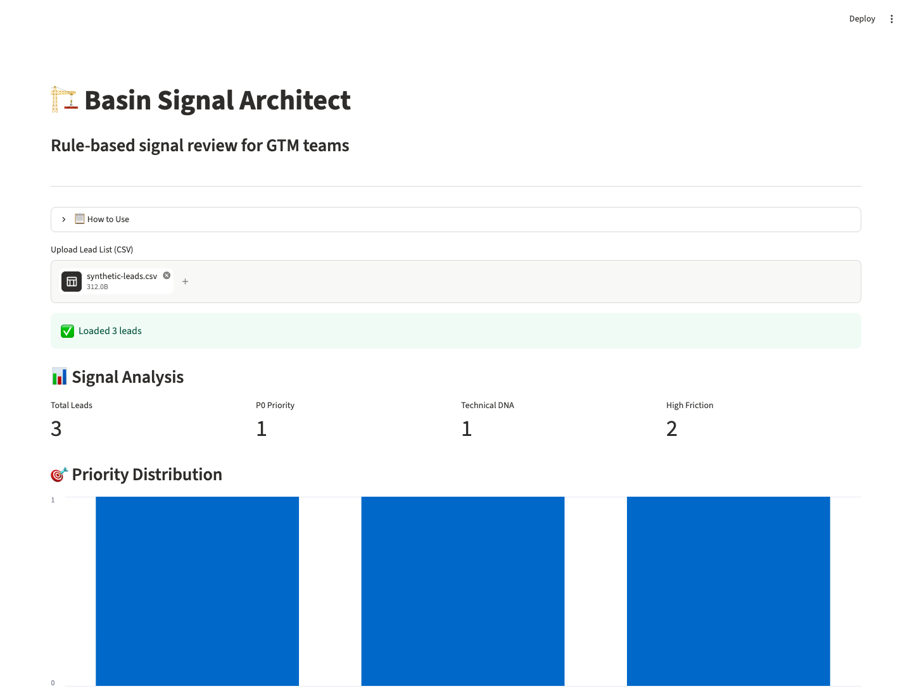

# Basin Signal Architect

A Python/Streamlit prototype for reviewing a CSV lead list with transparent keyword rules, assigning priority tiers, and exporting outreach drafts.

[Try the browser demo](https://basinleon.github.io/signal-architect/) · [Quick start](#quick-start) · [Synthetic input](examples/synthetic-leads.csv) · [Example output](examples/synthetic-results.csv) · [Operating context](https://basinleon.github.io/gtm-systems/)



## Try it in your browser

[Open Signal Architect](https://basinleon.github.io/signal-architect/). Load a fictional company, change a title or description, and inspect every match and the applied priority rule. The demo runs entirely in the browser, without input uploads, analytics requests, or automatic storage. It covers scoring; the Python app below also generates template drafts and CSV exports. The browser port was checked against the Python implementation across 640 input combinations. [Inspect the browser source and tests](https://github.com/BasinLeon/basinleon.github.io/tree/main/signal-architect).

## What it does

1. Reads a CSV locally through a Streamlit upload.
2. Counts sales/GTM keyword matches across the row.
3. Buckets technical and sales keywords into the UI's “Company DNA” categories.
4. Assigns P0–P3 priority using those rules.
5. Generates template-based email and LinkedIn drafts, then exports the selected rows as CSV.

The current app uses rules and text templates. It makes no LLM API calls and needs no API key. It does not send messages or connect to a CRM.

## Quick start

Requires Python 3.10 or newer. From a terminal:

```sh
git clone https://github.com/BasinLeon/gtm-signal-architect.git
cd gtm-signal-architect
python3 -m venv .venv
source .venv/bin/activate
python -m pip install -r requirements.txt
python -m streamlit run app.py
```

On Windows, activate with `.venv\Scripts\activate` instead. Open the local address printed by Streamlit, usually `http://localhost:8501`.

Upload `examples/synthetic-leads.csv`. The screenshot above and the checked-in output use these fictional rows. The setup and example were checked with Python 3.13, Streamlit 1.67, and pandas 3.1 on November 13, 2026.

## Inspect one example

| Fictional company | Friction score | Keyword category | Priority |
| --- | --- | --- | --- |
| Northstar Demo | 3 | Technical DNA | P0 |
| Harbor Demo | 2 | Sales DNA | P2 |
| Meadow Demo | 0 | Mixed DNA | P3 |

Northstar's description contains “account executive,” “SDR,” and “revenue.” Its technical keywords meet the P0 rule. The result is reproducible from the input; it is not evidence about a real company.

The sample output includes all three processed rows for inspection. In the app, the export defaults to P0 and P1 with a minimum friction score of 1. Change those filters to export other rows. Downloaded filenames include a date.

## Input and output

Recommended input columns are `Company`, `Name`, `Title`, and `Description`. The analyzer scans all available row values; `Company` and `Name` also personalize the draft templates.

Output preserves the source columns and adds `Friction_Score`, `Friction_Signals`, `Company_DNA`, `DNA_Confidence`, `Basin_Priority`, `Email_Subject`, `Email_Body`, and `LinkedIn_Message`.

## Limits

- Keyword occurrence is not verified hiring activity or buying intent. Negation, old job descriptions, and irrelevant fields can produce false positives.
- “DNA” is an application label for a keyword category. Its confidence number is a rule-derived score, not a calibrated probability or a verified assessment of a person.
- Templates contain assumptions about the recipient. Verify them and edit each draft before use.
- This prototype is for interactive review; it has no production authentication, CRM synchronization, deliverability system, or outcome evaluation.
- Use the supplied synthetic data for evaluation. A shared Streamlit deployment would receive uploaded files on its server.

Built by [Leon Basin](https://basinleon.github.io/). [Read the public operating record](https://basinleon.github.io/build-record/).
